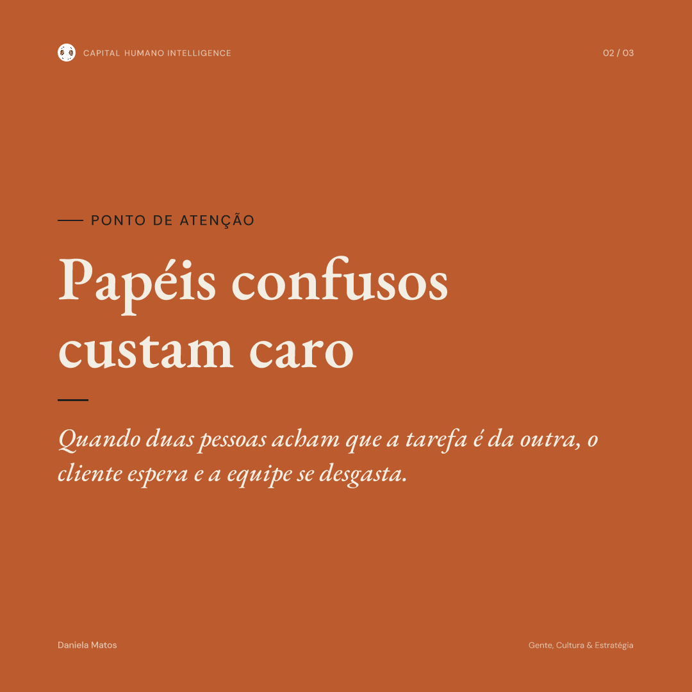
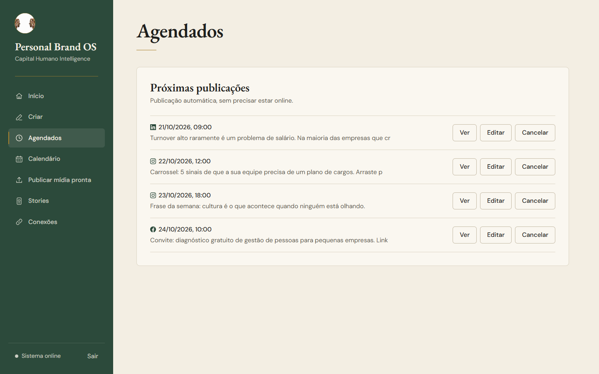
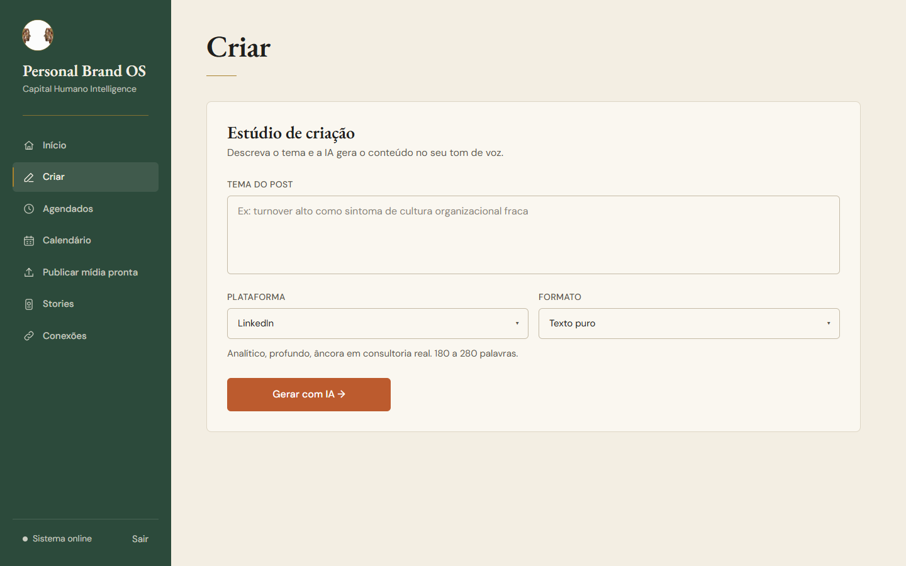
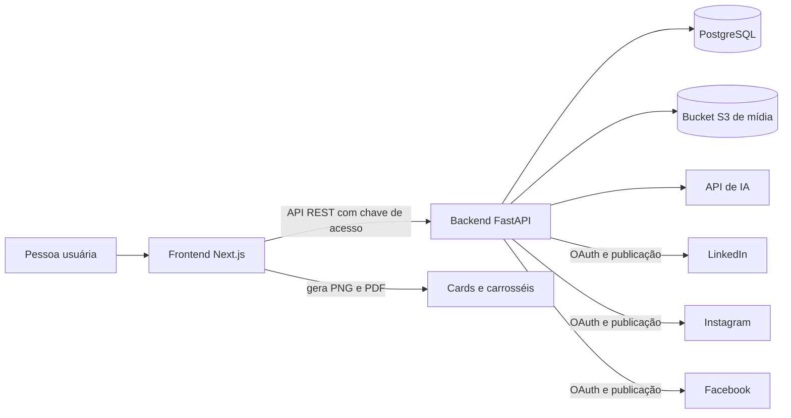

# Personal Brand Studio

Sistema para criar, agendar e publicar conteúdo de marca pessoal e de empresa no **LinkedIn**, no **Instagram** e no **Facebook**: cards e carrosséis com identidade visual, textos com apoio de IA, agenda de publicações e publicação automática.

Criado por Daniela Matos ([LinkedIn](https://www.linkedin.com/in/danielamatosfreitas)). Esta é a versão de vitrine do projeto: o mesmo código do app em uso, sem dados pessoais, sem chaves e com os endereços em variáveis de ambiente.

[English version below](#english)

| Card de capa | Card de alerta | Card de frase |
|---|---|---|
|  |  |  |

| Agenda de publicações | Estúdio de criação |
|---|---|
|  |  |

Os prints usam dados de exemplo.

## O problema

Quem produz conteúdo profissional com regularidade gasta muito tempo em tarefas repetidas: montar cada card no tamanho certo, conferir se o texto cabe, exportar carrossel em PDF para o LinkedIn, adaptar a legenda para cada rede e lembrar de publicar no horário. Ferramentas genéricas de design não garantem a identidade visual, e agendadores comuns não tratam bem carrossel em PDF no LinkedIn nem a publicação numa Página específica do Facebook.

## A solução

* **Estúdio de criação:** cards, carrosséis e stories gerados a partir do texto, com a identidade visual aplicada (fontes, cores, área segura). O texto é medido com a fonte real e o card é recusado se não couber, em vez de sair cortado.
* **IA para textos:** gera rascunhos no tom de voz configurado, com diretrizes diferentes para LinkedIn e Instagram.
* **Agenda:** posts agendados para LinkedIn (perfil ou página de empresa), Instagram e Facebook, com painel para ver, editar ou cancelar sem perder o agendamento.
* **Publicação automática:** o backend publica no horário, mesmo com o navegador fechado. Carrossel vai para o LinkedIn como documento PDF.
* **Travas de segurança:** tokens das redes guardados criptografados, publicação só na Página do Facebook configurada, falha numa rede não cancela a outra.
* **Calendário:** espelho só de leitura do calendário editorial, para consulta no celular.

## Arquitetura



* `frontend/`: Next.js 14 (App Router), React, TypeScript e Tailwind. Gera os cards no servidor com `next/og` (Satori e Resvg) e os PDFs com `pdf-lib`.
* `backend/`: Python 3.11, FastAPI, SQLAlchemy assíncrono e PostgreSQL. OAuth com LinkedIn, Instagram e Facebook, agendador de publicações, armazenamento de mídia em bucket S3 e integração com a API de IA.

## Tecnologias

* **Frontend:** Next.js 14, React 18, TypeScript, Tailwind CSS, next/og, opentype.js, pdf-lib.
* **Backend:** FastAPI, SQLAlchemy 2 (asyncpg), Pydantic, httpx, cryptography (Fernet), boto3, Pillow, pypdfium2.
* **Testes:** pytest com respx (chamadas externas simuladas) e o executor nativo do Node.js (`node --test`).
* **Hospedagem usada no app real:** Netlify (frontend) e Railway (backend e banco); qualquer serviço equivalente funciona.

## Como ver a demonstração

Para ver o app funcionando sem banco, sem backend e sem senha, com dados fictícios:

```bash
cd frontend
npm install
npm run demo
```

Abra `http://127.0.0.1:3210`. Você vai ver o painel com as contas de exemplo já conectadas, posts agendados para os próximos dias, o calendário da semana e o estúdio de criação gerando cards de verdade. Uma API de exemplo (`frontend/demo/api-demo.mjs`) responde no lugar do backend: publicar, agendar e conectar contas só simulam a resposta, e nada é enviado às redes. `Ctrl+C` encerra tudo. Se as portas 3210 ou 8710 estiverem ocupadas, escolha outras com `DEMO_PORTA_WEB` e `DEMO_PORTA_API`.

## Como rodar

### Backend

Precisa de Python 3.11 e PostgreSQL.

```bash
cd backend
python -m venv .venv
.venv\Scripts\activate
pip install -r requirements.txt
copy .env.example .env
uvicorn app.main:app --reload --port 8000
```

No Linux ou no Mac, ative o ambiente com `source .venv/bin/activate` e copie o arquivo com `cp .env.example .env`. Preencha o `.env` com os seus valores. O texto da persona usado pela IA fica em `config/persona.txt` (copie de `config/persona.example.txt`); esse arquivo não vai para o Git.

### Frontend

Precisa de Node.js 20 ou mais novo.

```bash
cd frontend
npm install
copy .env.example .env.local
npm run dev
```

Abra `http://localhost:3000` e entre com a senha definida em `APP_ACCESS_TOKEN` no backend.

## Como os testes funcionam

Nenhum teste fala com o LinkedIn, a Meta, o banco ou o bucket de verdade.

* **Backend (141 testes):** `cd backend`, `pip install -r requirements-dev.txt` e `pytest`. As chamadas às redes são simuladas com respx, e o `tests/conftest.py` define valores de teste para as variáveis de ambiente. Cobrem OAuth e segurança (estado, criptografia dos tokens), publicação no LinkedIn com documento, Instagram, Facebook (trava da Página certa, permissões), agendamento, edição sem cancelar, armazenamento de mídia e o espelho do Calendário.
* **Frontend (11 testes):** `cd frontend` e `npm test`. Cobrem a publicação em duas redes (falha numa não cancela a outra) e o espelho do Calendário.
* **Regressão visual (opcional):** `npm run regressao-visual`, com o servidor rodando, compara os cards renderizados no servidor e no navegador e trava fonte faltando.

## Antes de usar: crie os seus próprios apps

Este repositório **não traz nenhuma chave**. Para publicar, cada pessoa precisa criar os próprios apps e preencher o `.env`:

* **LinkedIn:** app em [developer.linkedin.com](https://developer.linkedin.com/) com os produtos de login e de publicação, e o endereço de retorno `.../api/v1/oauth/linkedin/callback`.
* **Meta (Instagram e Facebook):** app em [developers.facebook.com](https://developers.facebook.com/) com uma conta profissional do Instagram, uma Página do Facebook e os endereços de retorno do Instagram e do Facebook. O ID da Página entra em `FACEBOOK_PAGE_ID`.
* **IA:** chave própria em `ANTHROPIC_API_KEY`.

As permissões de publicação dessas plataformas passam por revisão delas, e as regras de uso de cada uma valem para quem usar o código.

## Licença

O código está sob a [licença MIT](LICENSE). A logo, o nome e a identidade visual da Capital Humano Intelligence (em `frontend/public/images/` e nos modelos de card) não fazem parte da licença: troque por uma identidade sua antes de usar. As fontes EB Garamond e DM Sans seguem a SIL Open Font License (arquivos em `frontend/public/fonts/`).

<a id="english"></a>

# Personal Brand Studio (English)

A system to create, schedule and publish personal and company brand content on **LinkedIn**, **Instagram** and **Facebook**: branded cards and carousels, AI assisted copy, a publishing calendar and automatic publishing.

Built by Daniela Matos ([LinkedIn](https://www.linkedin.com/in/danielamatosfreitas)). This is the showcase version of the project: the same code as the app in use, with no personal data, no keys, and addresses moved to environment variables. The interface is in Portuguese.

## The problem

Producing professional content regularly takes a lot of repetitive work: building every card at the right size, checking that the text fits, exporting carousels as PDF for LinkedIn, adapting captions for each network and remembering to publish on time. Generic design tools don't enforce a visual identity, and common schedulers handle LinkedIn PDF carousels and publishing to one specific Facebook Page poorly.

## The solution

* **Creation studio:** cards, carousels and stories generated from text, with the visual identity applied (fonts, colors, safe area). Text is measured with the real font and a card is rejected if it doesn't fit, instead of being cut.
* **AI copy:** drafts in a configured voice, with different guidelines for LinkedIn and Instagram.
* **Calendar:** posts scheduled for LinkedIn (profile or company page), Instagram and Facebook, with a panel to view, edit or cancel without losing the schedule.
* **Automatic publishing:** the backend publishes on time, even with the browser closed. Carousels go to LinkedIn as PDF documents.
* **Safety rails:** network tokens stored encrypted, publishing only to the configured Facebook Page, a failure on one network doesn't cancel the other.

The architecture diagram is in the Portuguese section above.

## Tech stack

* **Frontend:** Next.js 14, React 18, TypeScript, Tailwind CSS, next/og, opentype.js, pdf-lib.
* **Backend:** Python 3.11, FastAPI, async SQLAlchemy 2 (asyncpg), PostgreSQL, Pydantic, httpx, cryptography (Fernet), boto3, Pillow, pypdfium2.
* **Tests:** pytest with respx (mocked external calls) and the built in Node.js test runner.
* **Hosting used by the live app:** Netlify (frontend) and Railway (backend and database).

## Demo

To see the app running with fictitious data, without a database, a backend or a password: `cd frontend`, `npm install`, `npm run demo`, then open `http://127.0.0.1:3210`. A sample API (`frontend/demo/api-demo.mjs`) answers in place of the backend; publishing, scheduling and connecting accounts are only simulated and nothing reaches the social networks. `Ctrl+C` stops everything.

## Running

Backend (Python 3.11 and PostgreSQL): `cd backend`, create a virtual environment, `pip install -r requirements.txt`, copy `.env.example` to `.env`, fill in your values and run `uvicorn app.main:app --reload --port 8000`. The AI persona text lives in `config/persona.txt` (copy it from `config/persona.example.txt`), which is not committed.

Frontend (Node.js 20 or newer): `cd frontend`, `npm install`, copy `.env.example` to `.env.local` and run `npm run dev`. Open `http://localhost:3000` and sign in with the `APP_ACCESS_TOKEN` defined in the backend.

## Tests

No test talks to LinkedIn, Meta, the database or the real bucket.

* **Backend (141 tests):** `cd backend`, `pip install -r requirements-dev.txt`, `pytest`. External calls are mocked with respx and `tests/conftest.py` sets test values for the environment variables. They cover OAuth and security, LinkedIn document publishing, Instagram, Facebook (right Page lock, permissions), scheduling, editing without cancelling, media storage and the calendar mirror.
* **Frontend (11 tests):** `cd frontend`, `npm test`.

## Before using it: create your own apps

This repository ships **no keys**. To publish, you must create your own apps and fill in `.env`: a LinkedIn app at [developer.linkedin.com](https://developer.linkedin.com/), a Meta app at [developers.facebook.com](https://developers.facebook.com/) (with an Instagram professional account and a Facebook Page, whose ID goes in `FACEBOOK_PAGE_ID`) and your own `ANTHROPIC_API_KEY`. Publishing permissions go through each platform's review, and their terms apply to anyone using this code.

## License

The code is released under the [MIT license](LICENSE). The Capital Humano Intelligence logo, name and visual identity (in `frontend/public/images/` and in the card templates) are not covered by the license: replace them with your own identity before use. The EB Garamond and DM Sans fonts are under the SIL Open Font License (files in `frontend/public/fonts/`).
